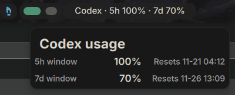

# Codex Status for DankBar

See your remaining Codex quota and review approval requests from the DankBar
panel. The widget connects to the native Codex background server, so approvals
work when you start Codex from your terminal as usual.



## Install

You need DankMaterialShell, Python 3, and Codex CLI. Sign in with ChatGPT to
use the account quota display. On Arch Linux, install the WebSocket library
if you plan to use approvals:

```sh
sudo pacman -S --needed python-websockets
```

From the repository root, copy the plugin into the DMS plugins directory:

```sh
dms_plugins="${XDG_CONFIG_HOME:-$HOME/.config}/DankMaterialShell/plugins"
mkdir -p "$dms_plugins"
cp -R CodexStatus "$dms_plugins/"
```

1. Open **Settings → Plugins**, scan for plugins, and enable **Codex Status**.
2. Add **Codex Status** in **Settings → DankBar**.
3. To use approvals, turn on **Approvals in DankBar** in the plugin settings.
   Start Codex with `codex` from your project directory.

To update an existing installation, copy the plugin again and run `dms restart`.

## Use the widget

- **Usage** shows the remaining percentage for each available quota window.
  Click the widget to see reset times in your local time zone. The widget
  refreshes when it starts and every five minutes.
- **Approval required** appears when a connected session needs your decision.
  Click to review the command, paths, diff, or permissions and choose **Allow
  once**, **Deny**, or **Cancel turn**, depending on the request. You can still
  answer in the terminal.

If the panel asks you to start Codex, check your daemon with
`codex app-server daemon version`. You can also start it explicitly with
`codex app-server daemon start`. By default the widget looks for the socket
at `${CODEX_HOME:-$HOME/.codex}/app-server-control/app-server-control.sock`.
Set **App Server socket** to an absolute path if the daemon uses a custom socket
or if your terminal and desktop session use different `CODEX_HOME` values.

### Proxy and CLI path

Set **Codex CLI path** if DankBar cannot find Codex. Use the absolute path to
the executable or to your proxy wrapper. In zsh, `whence -p codex` finds the
executable even when `codex` is an alias.

**Proxy URL** applies to the usage check and accepts HTTP(S) and SOCKS5 URLs
without credentials, such as `http://127.0.0.1:7890`. For approvals, start the
native daemon from your usual proxy-enabled terminal. It inherits the proxy
environment when it starts.

## Development

Run the Python tests from the repository root:

```sh
uv run python -m unittest discover -s tests
```

The tests use local fixtures and run without a Codex login. After editing QML,
reload the installed plugin with `dms ipc call plugins reload codexStatus`.

[MIT License](LICENSE)
